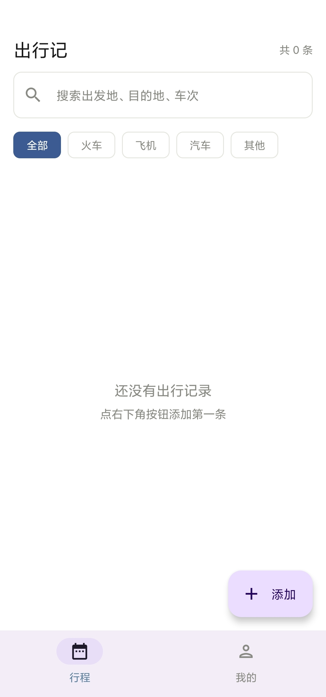
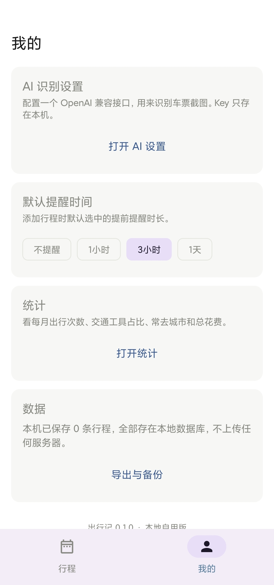

# 出行记 TripLog

记录行程的安卓应用。车票截个图丢进去，识别出车次、时刻、席别、票价，存进本地数据库，按时间线排好。

不联网也能用，手动录入不受影响。开着网的话，唯一出站的请求是打你自己配的那家 AI 接口。

[**下载 APK**](https://github.com/LinQi-QAQ/TripLog/releases/latest) · minSdk 26（Android 8.0）· 13 MB · 无广告无统计

<p align="center">
  
  
</p>

## 功能

- **票据识别**。选图或拍照后，图先压到长边 1568px、JPEG 质量 85 存本地，并按 EXIF 校正方向；识别时读这份本地副本，编成 base64 data URL 送进多模态模型。模型返回 JSON，解析分三层：先剥掉 ```` ```json ```` 围栏和前后废话，再逐字段宽容取值（该给字符串的地方给了对象就转 JSON 文本塞进备注），全失败则保留原文让你手填
- **行程管理**。Room 持久化，列表按出发时间分「即将出发」和「历史」两段，前者正序让最近的排最上。支持全文搜索、按交通工具筛、左滑删除、长按多选
- **出发提醒**。AlarmManager 精确闹钟，可选提前 1 小时 / 3 小时 / 1 天，也可关掉；`BOOT_COMPLETED` 广播里重建全部闹钟，重启不丢
- **出行统计**。年度总览、交通工具占比、常去城市 Top N、月度明细、总花费。纯 Kotlin 计算，不碰 Android API，单测直接跑
- **备份**。整个库连同票据图打包成 zip，内含 `data.json` 加 `tickets/` 目录，走 SAF 读写，换机可用
- **多交通工具**。火车、飞机、汽车同一套数据模型，字段按类型显示

## 隐私

- 数据库、票据图、配置全在应用私有目录，无账号系统，无云端同步
- 卸载即清空
- 依赖树里没有广告 SDK、统计 SDK、崩溃上报 SDK
- **只有票据识别这一条链路会出网**：图片编码成 base64 后 POST 到你自己填的接口（DeepSeek、OpenAI、通义、智谱，或任何 OpenAI 兼容端点）。命中什么服务商、留存多久，取决于你选的那家。别拿含身份证号、护照号的图去识别

## 技术栈

| 层 | 方案 |
|---|---|
| 语言 | Kotlin 2.2.20 |
| UI | Jetpack Compose + Material 3（BOM 2025.09.01） |
| 架构 | 单 Activity，Navigation Compose，ViewModel + StateFlow |
| 持久化 | Room 2.8.2，手写 DAO，无 TypeConverter |
| DI | 手写 `AppContainer`，没上 Hilt，构建快、省 KSP 开销 |
| 网络 | OkHttp 5.1，`kotlinx.serialization` 手写 JSON 树解析 |
| 图片 | Coil 2.7；写入时走 `ExifInterface` 校正 + 缩放 |
| 密钥 | `EncryptedSharedPreferences`（AES256-GCM / AES256-SIV），Keystore 托管主密钥 |
| 构建 | AGP 8.13.0，Gradle 8.14.3，JDK 17 编译，`compileSdk` / `targetSdk` 36 |

## 自己构建

环境要求：Android Studio（自带 SDK 即可）、JDK 17。

```bash
git clone https://github.com/LinQi-QAQ/TripLog.git
cd TripLog

./gradlew assembleDebug      # 调试包，产物含 -debug 后缀
./gradlew assembleRelease    # 发布包，需要下方签名配置
```

产物在 `app/build/outputs/apk/`。

**注意 JDK 版本**：Gradle 8.14.3 与 Kotlin 2.2.20 都不认 JDK 25 的版本号，会抛 `IllegalArgumentException: 25.0.3`。Android Studio 自带的是 JDK 25，所以本机构建时 `JAVA_HOME` 要显式指向 JDK 17 或 21。不要把这个路径写进 `gradle.properties`，那个文件是入库的，CI 上会因为你本机的 Windows 路径直接崩。写 `local.properties`（已 gitignore）或者只设环境变量。

### 发布签名

`build.gradle.kts` 会读根目录的 `keystore.properties`，文件不存在时 release 退化为未签名，debug 不受影响。

```properties
storeFile=your-release.jks
storePassword=你的密钥库口令
keyAlias=你的别名
keyPassword=你的密钥口令
```

`storeFile` 走 `file()`，相对 **app 模块目录**解析，不是仓库根目录——放错位置会报 `Keystore file not found`。这是本项目踩过的坑。

生成密钥库：

```bash
keytool -genkeypair -v -keystore your-release.jks -alias your \
  -keyalg RSA -keysize 4096 -validity 10950
```

PKCS12 格式下 `keyPassword` 会被强制与 `storePassword` 一致，keytool 会提示。

`keystore.properties`、`*.jks` 均在 `.gitignore` 中。

### AI 接口配置

应用内「我的 → AI 设置」，三个字段：

- **接口地址**：填到 `/v1` 这一层，程序拼 `/chat/completions`。如 `https://api.deepseek.com/v1`
- **模型名**：必须支持图片输入。如 `deepseek-vl2`、`qwen-vl-max-latest`、`gpt-4o-mini`
- **API Key**：加密落到本机，不明文存盘

系统提示词写在 `SettingsStore.DEFAULT_SYSTEM_PROMPT`，应用内可改。请求体是标准 OpenAI 多模态格式（`messages[].content` 里放 `text` 和 `image_url` 两种 part），`temperature` 固定 0。

## 测试

```bash
./gradlew testDebugUnitTest          # 149 个用例，Robolectric，无需设备
./gradlew connectedDebugAndroidTest  # 需要真机或模拟器
```

单测覆盖 Room 增删改查、表单校验、AI 返回的容错解析、备份 zip 往返、统计计算，以及 Compose 界面的渲染与交互断言。界面测试用 Robolectric 在 JVM 上跑真实 Compose，不出设备。

## 目录结构

```
app/src/main/java/com/linqi/triplog/
├── ai/
│   ├── AiClient.kt          OkHttp 发多模态请求，三层容错解析
│   └── TicketInfo.kt        识别结果数据类
├── data/
│   ├── backup/              zip 导入导出（data.json + tickets/）
│   ├── image/               EXIF 校正、缩放、落盘
│   ├── local/               Room 实体、DAO、数据库单例、加密配置存储
│   ├── repo/                仓库层，搜索与筛选
│   └── stats/               统计计算，纯 Kotlin
├── remind/                  AlarmManager 调度、通知、开机重建
├── ui/                      各页面 Compose，按 feature 分包
└── di/AppContainer.kt       手写依赖容器
```

更多实现细节见 [docs/开发笔记.md](docs/开发笔记.md)。

## 发新版

推 `v*` 标签触发 `.github/workflows/build.yml`，在 runner 上编译、签名、发 Release，不用本地打包。

```bash
git tag v1.1.0
git push origin v1.1.0
```

workflow 用的是 GitHub 自带 SDK（runner 上 `ANDROID_HOME` 已配好），只补装 `platforms;android-36` 和 `build-tools;36.0.0`。签名材料从仓库 Secrets 还原：`KEYSTORE_BASE64`、`KEYSTORE_PASSWORD`、`KEY_ALIAS`、`KEY_PASSWORD`。

密钥库转 base64：

```bash
base64 -i release.jks | tr -d '\n' | pbcopy                              # macOS
base64 -w0 release.jks                                                   # Linux
[Convert]::ToBase64String([IO.File]::ReadAllBytes("release.jks"))        # Windows
```

## 许可

MIT，见 [LICENSE](LICENSE)。
